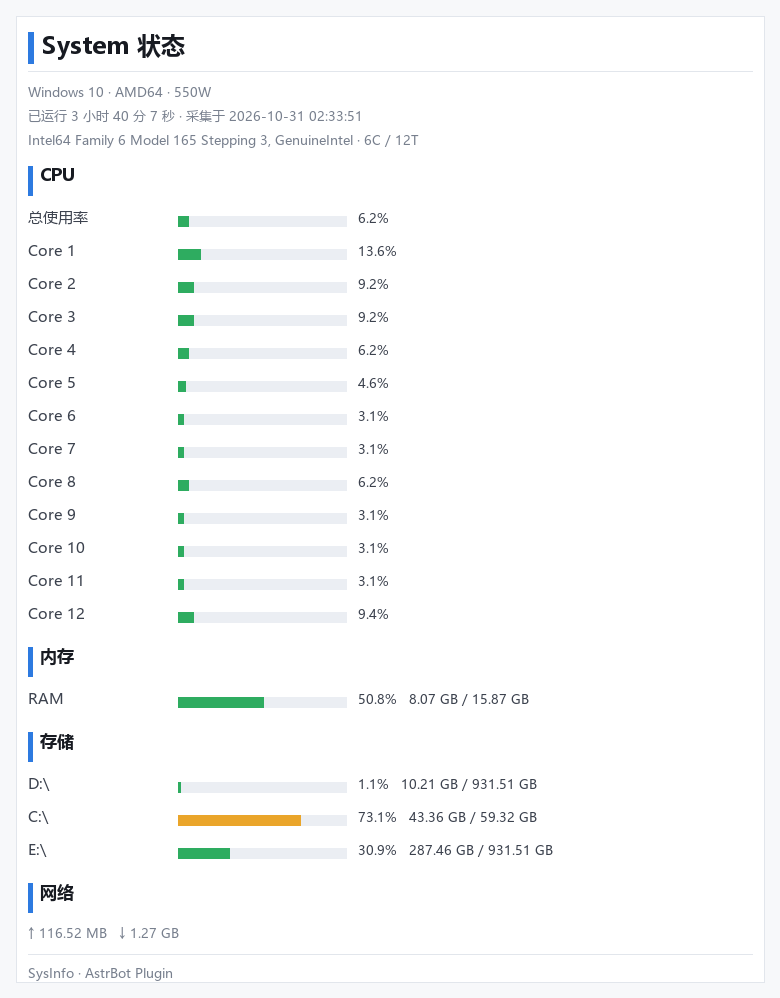

# 系统状态（astrbot_plugin_sysinfo）

一句话查看服务器的实时运行状态：CPU 总使用率、每个核心的使用率、内存、磁盘存储，以及可选的 Swap、网络流量、负载和温度。支持 **文本** 与 **图片卡片** 两种输出形式。



> 目录名 `astrbot_plugin_sysinfo` 即插件 ID，请勿重命名；WebUI 中的展示名是「系统状态」。

---

## 1. 安装

三种方式任选其一，装完都需要 **重载 / 重启** 才会生效（见第 3 节 RELOAD 说明）。

- **方式 A｜WebUI 上传 ZIP（推荐）**
  插件页 → 右下角 `+` → 从文件安装 → 选择本仓库根目录的 `astrbot_plugin_sysinfo.zip`。

- **方式 B｜手动放置**
  把 `astrbot_plugin_sysinfo/` 整个文件夹解压到 AstrBot 工作目录的 `data/plugins/` 下，得到：
  ```
  data/plugins/astrbot_plugin_sysinfo/
      main.py
      sysinfo_core.py
      metadata.yaml
      _conf_schema.json
      requirements.txt
      logo.png
      README.md
  ```

- **方式 C｜命令行**
  ```bash
  astrbot plug install <本插件仓库 URL>
  ```

依赖（`requirements.txt`）会在安装时 **自动安装**，`psutil>=5.9.0` 与 `Pillow>=10.0.0`。
自动安装失败时，手动补装：

```bash
# 找到 AstrBot 正在使用的那个 Python 解释器（不是随便一个 python）
pip install -r data/plugins/astrbot_plugin_sysinfo/requirements.txt
```

装完依赖记得回来 **重载插件**（第 3 节场景二），这一步很容易忘。

---

## 2. 使用

### 命令

| 命令 | 说明 |
| --- | --- |
| `/sysinfo` | 主命令，查看服务器状态 |
| `/sys` | 别名 |
| `/status` | 别名 |
| `/系统状态` | 别名 |
| `/服务器状态` | 别名 |

### LLM 工具

插件注册了名为 `get_server_status` 的函数工具。在 **人格 → 人格能力** 中允许该工具后，可以直接用自然语言提问，例如「服务器现在卡不卡」「还剩多少硬盘空间」，模型会自行调用。

### 输出示例

配置 `report_style=concise` 时（与紧凑列表风格一致）：

```
#System状态
-CPU：2.2% 使用
-Core1：5.3% 使用
-Core2：5.3% 使用
...
-RAM：48.9% 使用（7.76 GB / 15.87 GB）
-存储[C:\]：73.1% 占用（43.35 GB / 59.32 GB）
```

配置 `report_style=detailed` 时（默认，带进度条和附加模块）：

```
🖥 服务器状态
系统：Windows 10（AMD64）
运行：3 小时 13 分 25 秒
规格：6 核 / 12 线程
────────────────
CPU 总使用率    2.9%  ░░░░░░░░░░
  Core 1       3.1%  ░░░░░░░░░░
RAM           47.0%  █████░░░░░  7.46 GB / 15.87 GB
存储 C:\     73.1%  ███████░░░  43.34 GB / 59.32 GB
```

---

## 3. RELOAD（重载）使用说明

AstrBot 采用 **运行时注入** 的方式加载插件，改动代码或补装依赖后，必须让 AstrBot 重新加载插件才会生效。请按场景选择对应方式。

### 场景一｜修改了插件代码 / 改了插件配置 → 手动重载

1. 打开 AstrBot **WebUI → 插件 → 已安装**；
2. 找到「系统状态」，点击卡片右上角的 **`...`** 按钮；
3. 选择 **重载插件**。

重载会在不停机的情况下重新加载本插件的代码，不影响其他插件和运行中的会话。
本插件重载时会调用自带的 `terminate()` 钩子释放资源，无残留后台任务。

### 场景二｜插件加载失败 / 依赖没装上 → 一键重载修复

典型症状：插件卡片显示红色错误，日志里出现 `ModuleNotFoundError: No module named 'psutil'` 之类。

1. 先按第 1 节的命令手动补装缺失依赖，**确认 pip 装到的是 AstrBot 自己那个解释器**；
2. 回到 WebUI 插件页，在插件的错误提示中点击 **「尝试一键重载修复」**；
3. 若仍失败，走场景一：手动点 `...` → 重载插件。

### 场景三｜开发调试 → 开启自动热重载

改代码频率高时，不必每次手动点重载：

```bash
astrbot run --reload      # 推荐：CLI 直接开启
# 或等价于：
ASTRBOT_RELOAD=1 astrbot run
```

开启后保存文件即可看到日志 `检测到插件文件变化，正在重载...`，自动完成重载（依赖 `watchfiles`，未安装时先 `pip install watchfiles`）。

### 场景四｜首次安装 / systemd 部署 → 重启进程

**新增插件不会被热重载发现**——插件目录是在 AstrBot *启动时* 扫描的。首次安装请直接重启：

```bash
sudo systemctl restart astrbot      # systemd 部署
sudo journalctl -u astrbot --since "1 min ago" --no-pager | grep -i sysinfo   # 确认加载结果
```

Docker 部署则 `docker compose restart astrbot`；前台运行时 `Ctrl+C` 后重新 `astrbot run`。

### ⚠️ 两个容易踩的坑

1. **自动重载可能不会刷新 `sysinfo_core.py`。**
   本插件由 `main.py` 和 `sysinfo_core.py` 两个文件组成。AstrBot 的热重载只重建插件主类实例，受 Python 模块缓存影响，**单独修改 `sysinfo_core.py` 后可能不生效**。
   解决办法：改完二级模块后再手动点一次重载，或直接重启 AstrBot。

2. **用 systemd 托管时，默认没有开启自动热重载。**
   `ASTRBOT_RELOAD` 环境变量默认是关闭的。需要的话：

   ```bash
   sudo systemctl edit astrbot
   # 加入：
   # [Service]
   # Environment="ASTRBOT_RELOAD=1"
   sudo systemctl daemon-reload && sudo systemctl restart astrbot
   ```

---

## 4. 配置项

WebUI → 插件 → 系统状态 → 配置，或直接编辑 `data/config/astrbot_plugin_sysinfo_config.json`（改完按第 3 节重载）。

| 配置项 | 类型 | 默认值 | 说明 |
| --- | --- | --- | --- |
| `report_style` | string | `detailed` | `detailed` 带进度条的完整报告；`concise` 精简列表格式 |
| `sample_interval` | float | `1.0` | CPU 采样时长（秒）。越大越稳但响应越慢，0 为瞬时值 |
| `show_per_core` | bool | `true` | 是否显示每个核心的使用率 |
| `max_cores` | int | `0` | 最多显示多少核心，0 为不限；核心多的机器建议设 8~16 防刷屏 |
| `show_disk` | bool | `true` | 是否显示存储占用 |
| `disk_paths` | list | `[]` | 指定监控的挂载点，留空自动检测。Linux 填 `/`，Windows 填 `C:\` |
| `max_disks` | int | `3` | 最多显示多少分区 |
| `show_net` | bool | `true` | 显示网络累计收发流量 |
| `show_temp` | bool | `true` | 显示温度（需硬件/系统支持，多数 Linux 可用） |
| `max_temp_entries` | int | `3` | 最多显示几条温度数据 |
| `show_top_process` | bool | `false` | 显示内存占用 Top 进程 |
| `top_process_n` | int | `5` | Top 进程数量 |
| `render_image` | bool | `false` | 以图片卡片输出，需 Pillow；渲染失败自动回退文本 |
| `font_path` | string | 空 | 图片模式专用字体文件路径，留空自动探测；详见下方「图片模式的字体问题」 |
| `admin_only` | bool | `false` | 仅允许管理员查询 |

### 图片模式的字体问题（Docker 用户重点看）

精简版容器镜像往往 **不带中文字体**，图片里的中文会全部渲染成空心方框（□）。插件为此做了三层处理：

1. **自动探测**：扫描系统字体目录，逐个验证是否真的包含汉字字形（用缺字形方框做对照，避免误判）。
2. **找不到中文字体时自动降级**：整张卡片的标签切换为英文（`System Status` / `Total` / `Memory` / `Disk` / `Network`）**，数值不受影响，照样可读**，不会给你一张满是方框的图。
3. **手动指定字体**：把 `font_path` 指向一个中文字体，或干脆给容器装上中文字体（推荐）：

   ```bash
   # Debian / Ubuntu
   apt-get update && apt-get install -y fonts-noto-cjk
   # Alpine
   apk add --no-cache font-noto-cjk
   ```

   装完 **重载插件**（第 3 节场景一）即可切换回中文标签。常用路径：
   `/usr/share/fonts/opentype/noto/NotoSansCJK-Regular.ttc`

> 文本模式不受字体影响 —— 中文由聊天软件自己的字体渲染，所以即使在容器里也始终是正常的中文。

---

## 5. 常见问题

- **显示 `N/A` 而不是数字？**
  该指标在当前系统上取不到属于正常现象，插件不会用错误数字占位。常见情况：
  - Windows 不支持 `负载` 和大部分 `温度` 传感器；
  - macOS 多数机器读不到温度；
  - 容器内运行时读到的是宿主机的部分指标。

- **CPU 总使用率和各核心加起来对不上？**
  总使用率是窗口采样值，并非核心数值的简单算术平均，两者存在正常差异。

- **磁盘显示的分区不对 / 重复 / 出现了 `/etc/hostname`？**
  v1.2.0 起已自动处理：剔除伪文件系统（tmpfs、/proc、/sys、/dev 等）、剔除 Docker 注入的单文件挂载（`/etc/hostname`、`/etc/resolv.conf`），并把同一块盘的多个 bind mount 去重（例如容器里 `/` 与 `/AstrBot/data` 实为同一块盘，只显示一次）。
  仍不满意就在 `disk_paths` 中显式指定，例如 `["/"]` 或 `["C:\\"]`，并把 `max_disks` 设为 1。

- **命令没反应？**
  先确认插件已「打开」，再检查当前会话使用的 **配置文件** 与 **人格** 是否启用了本插件；不同配置文件需要分别开启。然后用第 3 节的重载方式刷新一次。

---

## 6. 兼容性

- Python 3.10+，AstrBot `>=3.5.0`
- 跨平台：Windows / Linux / macOS
- 仅读取本地系统状态，无任何外部网络请求；数据不落盘（图片模式会在系统临时目录生成一张 PNG）
